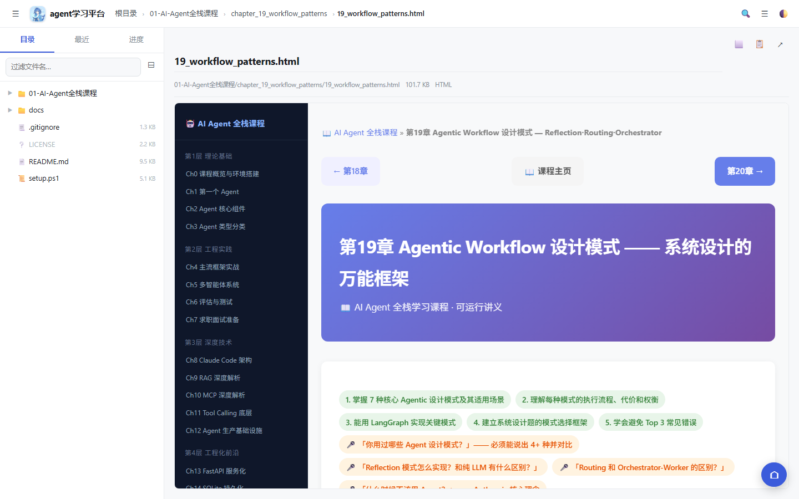
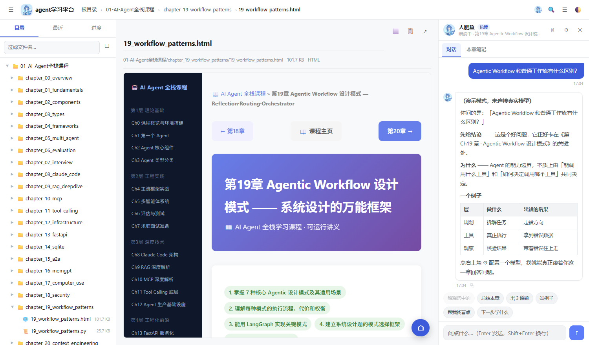

<div align="center">


# agent学习平台

**一个本地网页版学习平台** —— 为 [AI Agent 全栈课程](https://github.com/callous-0923/agent-study) 打造的离线阅读器

零第三方 Python 依赖 · 只监听本机 · 断网可用

[](https://gitee.com/haveink/agent-learning-platform)
[](https://github.com/LazyFox-007/Agent-Learning)



</div>

---

> 📍 **两个镜像，内容同步** —— 国内建议用 Gitee，访问快且稳定。
> - Gitee：https://gitee.com/haveink/agent-learning-platform
> - GitHub：https://github.com/LazyFox-007/Agent-Learning

---

## 这是什么

[AI Agent 全栈课程](https://github.com/callous-0923/agent-study) 是一套 37 章的开源课程，
每章包含一份**自包含的 HTML 讲义** + 一个**可运行的 Python 文件**。

讲义本身写得很好，但作为日常学习工具还缺一些东西：没法搜索、不知道读到哪了、37 章没有总览。
这个平台就是补上这些：

| 能力 | 说明 |
|---|---|
| 🐟 **AI 陪读** | 大肥鱼坐在右侧，知道你在读哪一章、选中了哪段 —— 划词即问、总结章节、出题考你 |
| 🔍 **全文搜索** | 跨 38 份 HTML + 37 个 Python 搜内容，不只是文件名 |
| 📊 **进度记录** | 自动标记已读，侧栏有进度条，首页有总体统计 |
| 🗺️ **学习路线** | 7 层结构 + 按目标选路径（新手 / 面试突击 / 构建产品 / 降本增效） |
| 📄 **多格式渲染** | Markdown、Jupyter Notebook、代码（带高亮）、PDF、图片 |
| 🧮 **数学公式** | KaTeX 渲染，不是显示 LaTeX 源码 |
| ✍️ **练习区（可选）** | 网页里改代码 → 保存到 `练习区/` → 一键运行看输出；`--ide` 开启，默认关闭 |
| 🌓 **明暗主题** | 跟随系统或手动切换 |
| 💾 **本地优先** | 只监听 `127.0.0.1`，不暴露、不上传；AI 密钥只存本机 |

<div align="center">

</div>

---

## 🐟 AI 陪读

按 `Ctrl+J` 或点右上角的吉祥物头像打开。它不是通用聊天框 —— **它一直知道你读到哪了**。



| 交互 | 效果 |
|---|---|
| **划词** | 在讲义里选中一段文字 → 上方冒出「问大肥鱼」→ 点击直接讲解这段 |
| **快捷指令** | 总结本章 · 出 3 道题考我 · 举例子 · 帮我找盲点 · 下一步学什么 |
| **自由问答** | 输入框问任何问题，回答自动带上「第 19 章 · 当前小节」的上下文 |
| **本章笔记** | 第二个标签页，跟章节走的便签，自动保存 |

**配置模型**：点面板右上角 ⚙，填 API Key 即可。支持任何 OpenAI 兼容服务：

| 服务商 | 需要什么 |
|---|---|
| DeepSeek（默认） | `api.deepseek.com` 的 key |
| 通义千问 / Kimi / OpenAI | 各自平台的 key |
| **Ollama 本地** | 不用 key，本机跑 `qwen2.5:7b` 之类 |
| **演示模式** | 完全不用配置，返回固定样例，先看效果 |

> 🔒 密钥只写在本机 `_webapp/data/ai-config.json`（已 gitignore），
> **不会回传给浏览器，也不会进版本控制**。前端只拿到掩码 `sk-abc…1234`。
>
> 设计细节与实现坑见 [docs/陪读设计.md](docs/陪读设计.md)。

---

## 快速开始

**需要**：Python 3.8+ · git
**不需要**：`pip install`、Node.js、联网、数据库

### 三步跑起来

```powershell
# 1) 克隆（国内用 Gitee，海外用 GitHub，两边内容一致）
git clone https://gitee.com/haveink/agent-learning-platform.git
cd agent-learning-platform

# 2) 启动 —— 课程已随仓库提供，断网也能读
cd _webapp
python server.py

# 3) 打开浏览器
#    http://127.0.0.1:8777/
```

浏览器一般会自动打开。**37 章讲义 + 12 章教材都在仓库里**，克隆完就有，不用额外下载。

> 端口被占用时会自动往后找（8777~8796），不会冲突。

### 配置 AI 陪读

**克隆下来默认是「演示模式」** —— 陪读面板能打开，但回答是预置示例，不是真模型。

配一次就好：

1. 打开页面 → 按 `Ctrl+J`（手机端点右下角的悬浮球）
2. 点右上角设置 → 选一个服务商（DeepSeek / Kimi / 通义 / OpenAI / 本地 Ollama）
3. 粘贴自己的 API Key → 点「保存并测试」

> **Key 只存在本机的 `_webapp/data/ai-config.json`**，不上传、不进仓库（`.gitignore` 已排除）。
> 换句话说：这个仓库里没有任何人的密钥，你得填自己的。

本机实测过 DeepSeek（`api.deepseek.com` + `deepseek-chat`），响应约 0.5 秒。

### 手机上用

手机版是**独立的一套单栏界面**（不是桌面版缩小），地址多一个 `/m`：

| 设备 | 地址 |
|---|---|
| 电脑 | `http://127.0.0.1:8777/` |
| 手机 | `http://<电脑局域网IP>:8777/m` |

手机要能访问，服务得绑到局域网那块网卡：

```powershell
python server.py --bind 192.168.1.100    # 换成你自己那块网卡的 IP
```

> 默认**只监听 `127.0.0.1`**，局域网里其他设备连不上 —— 这是故意的安全默认值。
> `--bind` 是把服务**额外**绑到你指定的那块网卡上，**它不带访问令牌**，所以要看绑的是哪块：
>
> - **USB 共享网络**（手机通过数据线连电脑）：绑那块网卡的 IP（常见 `172.31.x.x` / `192.168.42.x`），
>   只有这条链路能访问，相对安全 —— 推荐这种方式。
> - **同一 WiFi**：请改用 `--lan`（会要求 `?t=` 令牌）。**不要用 `--bind` 绑 WiFi 网卡的 IP**，
>   那等于把整个资料库开放给同一网段的所有设备。

**没有 Node.js 也能用。** Node 只在重新生成课程索引时才用到，首页数据已随仓库提供。

### 课程放在哪

资料根目录 = **仓库根目录**（`server.py` 往上两层）。想放别处：

```powershell
$env:STUDYAI_ROOT = "D:\我的书库"
python server.py
```

把自己的 Markdown / HTML / PDF 丢进去，刷新就能看到。

### _dev/setup.ps1 是干什么的

只在**想更新课程**的时候才需要：

```powershell
powershell -ExecutionPolicy Bypass -File _dev\setup.ps1
```

它会从 [上游仓库](https://github.com/callous-0923/agent-study) 重新拉一份最新课程，
做本地化转换（链接改写、移除统计脚本），再重新生成索引。
课程目录已经存在时它会自动跳过，不会覆盖你的东西。

---

## 项目结构

```
Agent-Learning/
├── _webapp/                     学习平台（双击 start.bat 启动）
│   ├── server.py                HTTP 层：路由 / 文件 / 搜索 / 统计
│   ├── app/                     后端模块
│   │   ├── ai.py                AI 陪读：预设 / 密钥 / 提示词 / 流式调用
│   │   ├── ide.py               练习区：保存到工作区 + 运行 Python
│   │   ├── courses.py           课程包校验（通过才出现在首页）
│   │   └── library.py           「我的书库」（--library 才启用）
│   ├── start.bat                Windows 双击启动
│   ├── data/                    本机私有配置（已 gitignore）
│   │   └── ai-config.json       ⬅ AI 密钥
│   ├── static/                  前端
│   │   ├── index.html           三栏布局 + 陪读面板
│   │   ├── app.js               目录树 / 搜索 / 进度 / 路由
│   │   ├── companion.js         🐟 AI 陪读（上下文 / 流式 / 选区 / 设置）
│   │   ├── ide/                 编辑器页（Monaco，保存 / 运行）
│   │   ├── renderers.js         Markdown / Notebook / 代码 / PDF 渲染
│   │   ├── roadmap.js           首页数据（由 dev/gen-roadmap.js 生成）
│   │   ├── style.css            主题变量都在 :root 里
│   │   └── vendor/              marked · KaTeX · highlight.js · Monaco
│   ├── tests/                   回归测试（纯标准库 unittest）
│   ├── assets/                  吉祥物图标与图标生成脚本
│   ├── dev/                     开发工具（生成器 / 渲染测试 / npm 依赖）
│   ├── logs/                    运行日志（已 gitignore）
│   └── shots/                   验证截图（已 gitignore）
│
├── 01-AI-Agent全栈课程/          ⬅ 37 章课程正文 + 源码，随仓库提供
│   ├── index.html               课程主页
│   ├── chapter_00_overview/     每章：讲义 .html + 源码 .py
│   ├── ...
│   ├── chapter_36_defense/
│   └── LICENSE                  上游课程授权
│
├── 02-AFA与进程代数/             本地数学教材（Markdown + KaTeX）
│
├── _dev/                        开发脚本（不参与阅读）
│   ├── setup.ps1                一键安装 / 更新课程
│   ├── scripts/
│   │   ├── import-agent-course.ps1   重新拉取课程 + 本地化转换
│   │   └── install-shell-menu.ps1    右键「用阅读器打开」
│   └── tools/                   视频导出、水印等辅助脚本
│
├── 书库/                        用户自己的资料（已 gitignore）
├── 练习区/                      编辑器里写的代码（已 gitignore）
├── docs/                        README 截图 + 陪读设计 + 维护笔记
├── LICENSE / THIRD-PARTY-NOTICES.md
└── .gitignore / .gitattributes
```

---

## 关于课程内容

**课程正文随本仓库一起分发**，克隆下来就能读，**不需要联网**。

| 项 | 值 |
|---|---|
| 原作者 | [callous-0923](https://github.com/callous-0923) |
| 协议 | MIT License（可自由使用、修改、分发） |
| 规模 | 37 章 · 38 份讲义 · 37 个可运行 Python |
| 上游 | https://github.com/callous-0923/agent-study |

版权归原作者所有。其原始 `LICENSE` 与署名保留在
[`01-AI-Agent全栈课程/LICENSE`](01-AI-Agent全栈课程/LICENSE)，**课程实质内容未做任何改动**。

引入时做了三处**只关乎离线可用的本地化转换**：

| 转换 | 规模 | 为什么必须做 |
|---|---|---|
| 绝对 URL → 相对路径 | 1,661 处 | 原讲义侧栏和上下章链接**硬编码**指向 `callous-0923.github.io`，不改则断网后无法翻页 |
| 移除 busuanzi 统计脚本 | 38 页 | 外部 CDN 的访问量统计，本地无意义 |
| 移除访问量徽章与残留 CSS | 38 页 | 同上 |

**课程实质内容零改动。** 上游 LICENSE 与署名完整保留，转换后自动校验：
站内导航链接 1,698 个全部可解析。

> 想支持作者的话，去 [原仓库](https://github.com/callous-0923/agent-study) 点个 ⭐。

---

## 技术说明

### 为什么加 `/files/` 路由

平台原本用 `/api/raw?path=...` 提供文件，但**浏览器解析相对链接时只用路径部分、会丢弃 query** ——
课程内所有相对导航都会失效。新增 `/files/<相对路径>` 按真实目录结构提供文件后解决。

### 路径安全

所有请求经 `realpath` 解析后必须落在根目录内。实测：

| 攻击向量 | 结果 |
|---|---|
| `/files/../../Windows/win.ini` | 404 拦截 |
| `/files/..%2F..%2FWindows%2Fwin.ini` | 403 拦截 |

### 缓存策略

`/static/` 下的文件**文件名不带版本哈希**，所以不能长缓存，否则改完看不到变化：

| 路径 | 策略 | 原因 |
|---|---|---|
| `app.js` / `style.css` / `roadmap.js` | `no-store` | 无哈希，长缓存会一直发旧内容 |
| `static/vendor/*` | 7 天 | 第三方固定版本库，内容永不变 |
| 图片 / 字体 | 7 天 | 同上 |

### 零依赖

`server.py` / `app/*.py` 全部只用 Python 标准库
（`http.server` / `json` / `gzip` / `mimetypes`），**不需要 `pip install` 任何东西**。

### 自动化测试

服务端有 22 项回归测试（纯标准库 `unittest`，不需要 pytest），覆盖路径越界、敏感文件拦截、
HEAD/Range 语义、超长 POST 不断连、GBK 搜索、KaTeX 注入、模型调用（用本地假接口，不花钱）：

```powershell
cd _webapp
python -m unittest discover -s tests -v
```

前端渲染另有 28 项检查：

```powershell
cd _webapp\dev
node test-render.js
```

---

## 常见问题

**Q：为什么不做成在线版？**
A：课程是纯静态 HTML，在线托管等于替原作者重新发布一遍。本地跑既尊重版权，也保证断网可用。

**Q：能放自己的资料吗？**
A：可以。往仓库根目录扔文件夹即可，平台会自动识别（`_` 开头的目录会被忽略）。

**Q：支持 Mac / Linux 吗？**
A：`server.py` 跨平台，`python server.py` 直接能跑。`setup.ps1` 和 `start.bat` 是 Windows 脚本，
其他系统手动执行 `_dev/scripts/import-agent-course.ps1` 里的 git clone 命令即可。

**Q：`git pull` 更新平台后，课程会跟着更新吗？**
A：不会。课程正文**已经随仓库提供**（`01-AI-Agent全栈课程/` 81 个文件、`02-AFA与进程代数/` 54 个文件），
但 `git pull` 只会更新平台代码，不会动课程内容。想拉上游最新版：删掉对应课程目录后重跑 `setup.ps1`。

**Q：页面内容和文件对不上怎么办？**
A：先 `Ctrl`+`F5` 强制刷新。静态资源已设 `no-store`，正常情况下不会再有缓存问题。

---

## 开发笔记

遇到过的坑与排查方法记录在 **[docs/维护笔记.md](docs/维护笔记.md)**，包括：

- 缓存策略为什么这么设计
- `.bat` 必须 CRLF 行尾 + 无 BOM（LF 会让 cmd 解析失败）
- `display` 会盖掉 `[hidden]` 属性
- HTML 宽屏模式的实现

---

## 许可

平台代码：[MIT](LICENSE) © 2026 LazyFox-007

课程内容：MIT © [callous-0923](https://github.com/callous-0923)

前端依赖：marked (MIT) · KaTeX (MIT) · highlight.js (BSD-3-Clause)

第三方内容声明详见 [THIRD-PARTY-NOTICES.md](THIRD-PARTY-NOTICES.md)
