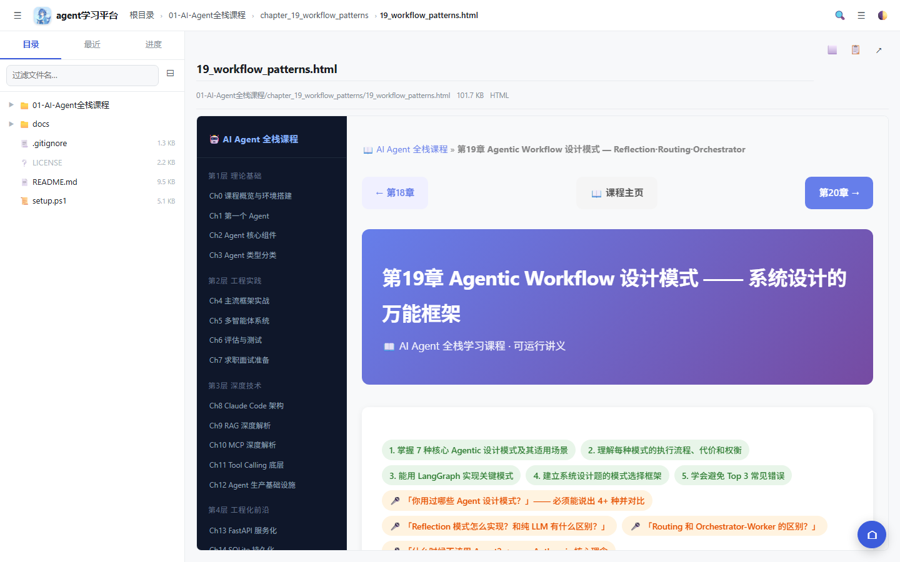
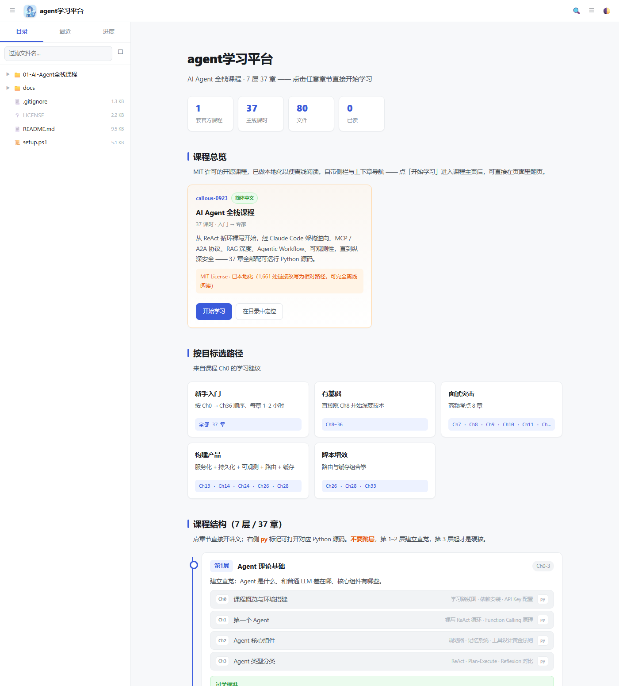

<div align="center">


# agent学习平台

**一个本地网页版学习平台** —— 为 [AI Agent 全栈课程](https://github.com/callous-0923/agent-study) 打造的离线阅读器

零第三方 Python 依赖 · 只监听本机 · 断网可用



</div>

---

## 这是什么

[AI Agent 全栈课程](https://github.com/callous-0923/agent-study) 是一套 37 章的开源课程，
每章包含一份**自包含的 HTML 讲义** + 一个**可运行的 Python 文件**。

讲义本身写得很好，但作为日常学习工具还缺一些东西：没法搜索、不知道读到哪了、37 章没有总览。
这个平台就是补上这些：

| 能力 | 说明 |
|---|---|
| 🔍 **全文搜索** | 跨 38 份 HTML + 37 个 Python 搜内容，不只是文件名 |
| 📊 **进度记录** | 自动标记已读，侧栏有进度条，首页有总体统计 |
| 🗺️ **学习路线** | 7 层结构 + 按目标选路径（新手 / 面试突击 / 构建产品 / 降本增效） |
| 📄 **多格式渲染** | Markdown、Jupyter Notebook、代码（带高亮）、PDF、图片 |
| 🧮 **数学公式** | KaTeX 渲染，不是显示 LaTeX 源码 |
| 🌓 **明暗主题** | 跟随系统或手动切换 |
| 💾 **完全离线** | 只监听 `127.0.0.1`，不联网、不暴露、不上传任何数据 |

<div align="center">

</div>

---

## 快速开始

**需要**：Python 3.8+ · git

```powershell
# 1) 克隆
git clone https://github.com/LazyFox-007/Agent-Learning.git
cd Agent-Learning

# 2) 一键安装（拉取课程 + 生成索引与路线数据）
powershell -ExecutionPolicy Bypass -File setup.ps1

# 3) 启动
cd _webapp
python server.py
```

浏览器会自动打开 **http://127.0.0.1:8777/**

> 端口被占用时会自动往后找（8777~8796），不会冲突。

**没有 Node.js 也能用。** Node 只在重新生成课程索引时才用到，首页数据已随仓库提供。

---

## 项目结构

```
Agent-Learning/
├── setup.ps1                    一键安装
├── LICENSE                      MIT（含第三方声明）
│
├── _webapp/                     学习平台
│   ├── server.py                HTTP 服务（纯标准库）
│   ├── start.bat                Windows 双击启动
│   ├── static/                  前端
│   │   ├── index.html           三栏布局
│   │   ├── app.js               目录树 / 搜索 / 进度 / 路由
│   │   ├── renderers.js         Markdown / Notebook / 代码 / PDF 渲染
│   │   ├── roadmap.js           首页数据（由 gen-roadmap.js 生成）
│   │   ├── style.css            主题变量都在 :root 里
│   │   └── vendor/              marked · KaTeX · highlight.js
│   ├── assets/                  吉祥物图标
│   └── _build/                  开发工具（生成器 + 渲染测试）
│
├── _scripts/
│   └── import-agent-course.ps1  拉取课程 + 本地化转换
│
├── docs/                        README 截图 + 维护笔记
└── 01-AI-Agent全栈课程/          ⬅ 由 setup.ps1 生成，不纳入版本控制
```

---

## 关于课程内容

**本仓库不包含课程正文。** 版权归原作者 [callous-0923](https://github.com/callous-0923) 所有，
遵循 MIT License。`setup.ps1` 会用 `git clone` 从上游拉取，并做三处**本地化转换**：

| 转换 | 规模 | 为什么必须做 |
|---|---|---|
| 绝对 URL → 相对路径 | 1,661 处 | 原讲义侧栏和上下章链接**硬编码**指向 `callous-0923.github.io`，不改则断网后无法翻页 |
| 移除 busuanzi 统计脚本 | 38 页 | 外部 CDN 的访问量统计，本地无意义 |
| 移除访问量徽章与残留 CSS | 38 页 | 同上 |

**课程实质内容零改动。** 上游 LICENSE 与署名完整保留，转换后自动校验：
站内导航链接 1,698 个全部可解析。

> 想支持作者的话，去 [原仓库](https://github.com/callous-0923/agent-study) 点个 ⭐。

---

## 技术说明

### 为什么加 `/files/` 路由

平台原本用 `/api/raw?path=...` 提供文件，但**浏览器解析相对链接时只用路径部分、会丢弃 query** ——
课程内所有相对导航都会失效。新增 `/files/<相对路径>` 按真实目录结构提供文件后解决。

### 路径安全

所有请求经 `realpath` 解析后必须落在根目录内。实测：

| 攻击向量 | 结果 |
|---|---|
| `/files/../../Windows/win.ini` | 404 拦截 |
| `/files/..%2F..%2FWindows%2Fwin.ini` | 403 拦截 |

### 缓存策略

`/static/` 下的文件**文件名不带版本哈希**，所以不能长缓存，否则改完看不到变化：

| 路径 | 策略 | 原因 |
|---|---|---|
| `app.js` / `style.css` / `roadmap.js` | `no-store` | 无哈希，长缓存会一直发旧内容 |
| `static/vendor/*` | 7 天 | 第三方固定版本库，内容永不变 |
| 图片 / 字体 | 7 天 | 同上 |

### 零依赖

`server.py` 只用 Python 标准库（`http.server` / `json` / `gzip` / `mimetypes`），
**不需要 `pip install` 任何东西**。

---

## 常见问题

**Q：为什么不做成在线版？**
A：课程是纯静态 HTML，在线托管等于替原作者重新发布一遍。本地跑既尊重版权，也保证断网可用。

**Q：能放自己的资料吗？**
A：可以。往仓库根目录扔文件夹即可，平台会自动识别（`_` 开头的目录会被忽略）。

**Q：支持 Mac / Linux 吗？**
A：`server.py` 跨平台，`python server.py` 直接能跑。`setup.ps1` 和 `start.bat` 是 Windows 脚本，
其他系统手动执行 `_scripts/import-agent-course.ps1` 里的 git clone 命令即可。

**Q：`git pull` 更新平台后，课程会跟着更新吗？**
A：不会，课程是 gitignore 的。删掉 `01-AI-Agent全栈课程/` 后重跑 `setup.ps1` 即可拉到上游最新版。

**Q：页面内容和文件对不上怎么办？**
A：先 `Ctrl`+`F5` 强制刷新。静态资源已设 `no-store`，正常情况下不会再有缓存问题。

---

## 开发笔记

遇到过的坑与排查方法记录在 **[docs/维护笔记.md](docs/维护笔记.md)**，包括：

- 缓存策略为什么这么设计
- `.bat` 必须 CRLF 行尾 + 无 BOM（LF 会让 cmd 解析失败）
- `display` 会盖掉 `[hidden]` 属性
- HTML 宽屏模式的实现

---

## 许可

平台代码：[MIT](LICENSE) © 2026 LazyFox-007

课程内容：MIT © [callous-0923](https://github.com/callous-0923)

前端依赖：marked (MIT) · KaTeX (MIT) · highlight.js (BSD-3-Clause)
