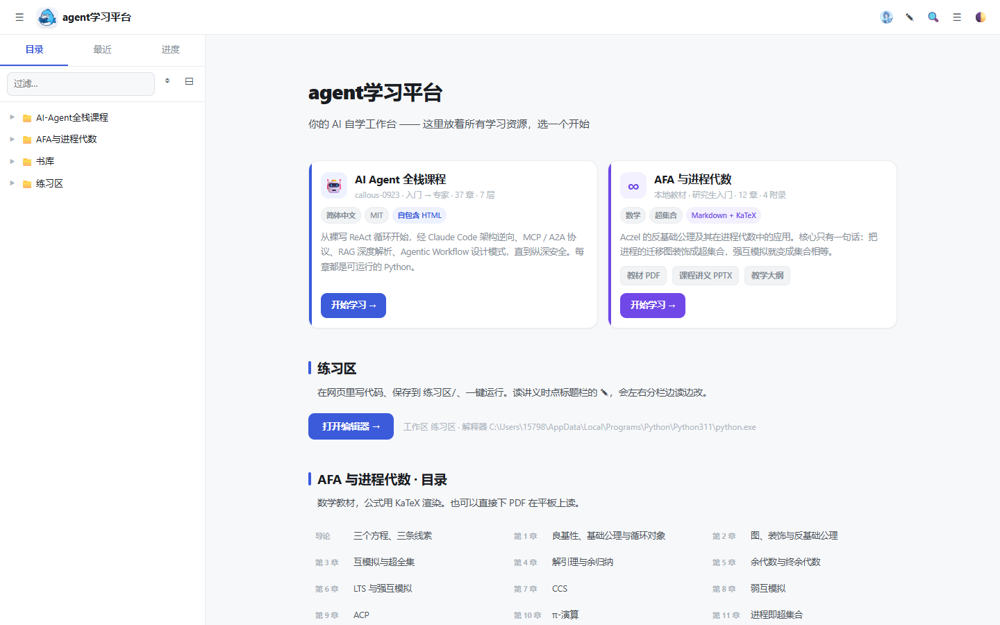
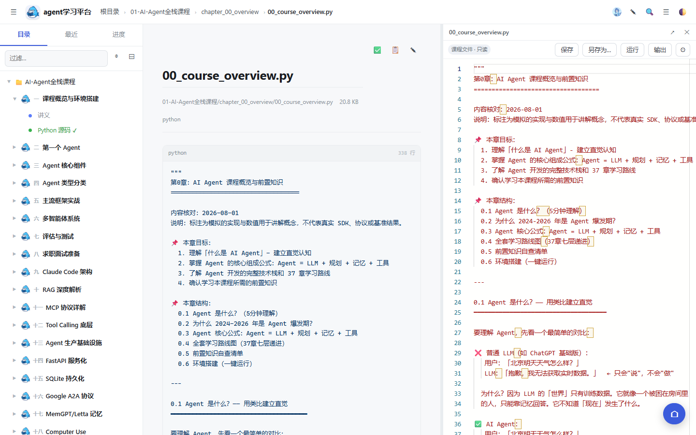

<div align="center">


# agent学习平台

**一个只在本机跑的 AI 学习工作台** —— 读课程、搜内容、问陪读，还能把代码写起来直接跑

零第三方 Python 依赖 · 只监听 `127.0.0.1` · 断网可用

[](https://gitee.com/haveink/agent-learning-platform)
[](https://github.com/LazyFox-007/Agent-Learning)



</div>

---

## 这是什么

一套**本地网页版学习平台**，为 [AI Agent 全栈课程](https://github.com/callous-0923/agent-study) 打造：

| 你本来会遇到 | 这个平台补上 |
|---|---|
| 37 份讲义是 HTML，读完不知道读到哪 | 自动记录进度，侧栏有进度条，首页有总体统计 |
| 想找"transformer 在哪讲过"只能一个个点 | 跨讲义 / 代码 / 教材的**全文搜索** |
| 遇到看不懂的段落，得复制出去问 AI | **大肥鱼陪读**：知道你在哪一章、选中了哪段 |
| 课程示例能读不能跑 | **练习区**：分栏编辑器，写完直接运行看输出 |

> 它不联网、不上传、不需要注册。所有数据都在你自己的电脑上。

---

## 快速开始

**需要**：Python 3.8+（不需要 `pip install` 任何东西）
**可选**：Node.js（只在重新生成首页数据时用到）

```powershell
git clone https://gitee.com/haveink/agent-learning-platform.git
cd agent-learning-platform\_webapp
python server.py            # 浏览器会自动打开
```

也可以直接**双击 `_webapp\start.bat`**。

| 地址 | 用途 |
|---|---|
| `http://127.0.0.1:8777/` | 电脑版 |
| `http://127.0.0.1:8777/m` | 手机版（独立单栏界面） |

> 端口被占用会自动往后找（8777→8796）。**同一份资料已经在跑时不会再起第二个实例**，
> 会直接打开浏览器并退出 —— 不会留下一堆占着端口却收不到请求的进程。

### 想边读边写代码：加 `--ide`

```powershell
python server.py --ide
```

阅读器里打开任意 `.py`，点标题栏的 ✎，右侧出现编辑器（可拖分隔条）；改完保存到 `练习区/`，点「运行」看输出。



> `--ide` 等于开放「写文件 + 执行 Python」，所以**默认关闭**，并且不能和 `--lan` / `--bind` 一起用。

---

## 功能

| 能力 | 说明 |
|---|---|
| 📄 **多格式渲染** | Markdown（KaTeX 公式 / 代码高亮 / 表格 / 图片）、Jupyter Notebook、代码、PDF、HTML |
| 🐟 **AI 陪读** | `Ctrl+J` 唤出。知道当前章节；划词即问；快捷键：总结本章 / 出题 / 举盲点 |
| 🔍 **全文搜索** | `Ctrl+K`，搜讲义、代码、教材（支持 GBK 编码文件） |
| 📊 **进度记录** | 打开 30 秒自动标记已读；侧栏进度条；首页统计 |
| ✍️ **练习区** | 分栏编辑器（Monaco）；保存到 `练习区/`；一键运行 Python（`--ide`） |
| 📱 **手机版** | `/m` 独立单栏界面，陪读改悬浮球 |
| 🌓 **明暗主题** | 跟随系统或手动切换 |
| 🗂 **书库** | 自己的 Markdown/PDF 资料也能读（`--library` 启用删除 / 排序） |
| 🔒 **本地优先** | 只监听回环地址；密钥只在本机文件；敏感目录不对外提供 |

### 快捷键

| 按键 | 作用 |
|---|---|
| `Ctrl K` / `/` | 打开全文搜索 |
| `Ctrl J` | AI 陪读 |
| `Ctrl B` | 收起 / 展开侧栏 |
| `Ctrl I` | 显示 / 隐藏右侧目录 |
| `Ctrl E` | 打开练习区编辑器 |
| `Ctrl S` | 编辑器里保存 |
| `Ctrl Enter` | 编辑器里运行 |
| `Esc` | 关闭搜索 / 对话框 |

---

## 目录结构

```
Agent-Learning/
├── _webapp/                     学习平台（双击 start.bat 启动）
│   ├── server.py                HTTP 层：路由 / 文件 / 搜索 / 统计
│   ├── app/                     后端模块
│   │   ├── ai.py                AI 陪读：预设 / 密钥 / 提示词 / 流式调用
│   │   ├── ide.py               练习区：保存到工作区 + 运行 Python
│   │   ├── courses.py           课程包校验（通过才出现在首页）
│   │   └── library.py           「我的书库」（--library 才启用）
│   ├── static/                  前端（无构建步骤）
│   │   ├── index.html           三栏布局 + 陪读面板 + 分栏编辑器容器
│   │   ├── app.js               目录树 / 路由 / 搜索 / 进度 / 分栏控制
│   │   ├── companion.js         AI 陪读
│   │   ├── ide/                 编辑器页（Monaco，保存 / 运行 / 设置）
│   │   ├── renderers.js         Markdown / Notebook / 代码 / PDF 渲染
│   │   └── vendor/              marked · KaTeX · highlight.js · Monaco
│   ├── data/                    本机私有配置（已 gitignore，不会提交）
│   ├── tests/                   回归测试（纯标准库 unittest）
│   ├── dev/                     开发工具（生成器 / 渲染测试 / npm 依赖）
│   ├── logs/ · shots/           运行日志 · 验证截图（已 gitignore）
│   └── assets/                  吉祥物与图标
│
├── 01-AI-Agent全栈课程/         37 章课程正文 + 源码
├── 02-AFA与进程代数/             本地数学教材（Markdown + KaTeX）
├── _dev/                        开发脚本（不参与阅读）
│   ├── setup.ps1                一键安装 / 更新课程
│   ├── scripts/                 导入课程、右键菜单安装
│   └── tools/                   视频导出、水印等辅助脚本
│
├── 书库/                        你自己的资料（已 gitignore）
├── 练习区/                      编辑器里写的代码（已 gitignore）
└── docs/                        截图 · 陪读设计 · 维护笔记
```

---

## 配置

### 资料根目录

默认是仓库根。想指向别处：

```powershell
$env:STUDYAI_ROOT = "D:\我的书库"
python server.py
```

### 本机配置文件（都在 `_webapp/data/`，已 gitignore）

| 文件 | 内容 |
|---|---|
| `ai-config.json` | 陪读用的模型与 API Key（接口只回显掩码，不回传明文） |
| `ide-config.json` | 练习区：`workspace` / `defaultDir` / `python` / `timeout` |
| `lan-token` | 局域网访问令牌（`--lan` 时自动生成） |

陪读支持任何 OpenAI 兼容服务（DeepSeek / 通义 / Kimi / OpenAI / 本地 Ollama），
也可以选「演示模式」完全不配置，先看界面。

### 手机访问

| 方式 | 命令 | 安全性 |
|---|---|---|
| USB 共享网络 | `python server.py --bind <那块网卡的 IP>` | 只有那条链路能访问 |
| 同一 WiFi | `python server.py --lan` | 需要 `?t=令牌`，启动时会打印完整地址 |

> 默认只绑 `127.0.0.1`。**不要用 `--bind` 绑 WiFi 网卡的 IP** —— 那不带令牌，
> 等于把资料库开放给同网段所有设备；WiFi 场景请用 `--lan`。

---

## 安全边界

| 项 | 做法 |
|---|---|
| 监听 | 默认只有 `127.0.0.1` |
| 路径 | `realpath` 解析后必须落在资料根内，越界返回 403 |
| 敏感文件 | `_webapp/`、`data/`、`logs/`、`dev/`、`.git/` 一律不从 HTTP 提供 |
| 密钥 | 只存本机；接口只回显掩码；不转发给浏览器 |
| 练习区 | 只能写工作区；`../`、绝对路径、盘符一律拒绝；运行超时强杀，输出截断 |
| 大文件 | 文本 > 8 MB 不读，二进制 > 64 MB 不传 |

---

## 测试

```powershell
cd _webapp
python -m unittest discover -s tests -v     # 服务端 38 项
cd dev
node test-render.js                          # 前端渲染 28 项（需先 npm install）
```

测试会自建临时资料根，**不会碰**真实的课程、书库和 `data/` 里的配置。

---

## 课程来源与许可

| 项 | 值 |
|---|---|
| 原作者 | [callous-0923](https://github.com/callous-0923) |
| 协议 | MIT License（可自由使用、修改、分发） |
| 规模 | 37 章 · 38 份讲义 · 37 个可运行 Python |
| 上游 | https://github.com/callous-0923/agent-study |

课程正文随仓库一起分发，克隆完即可离线阅读。引入时只做了三处**为了离线可用**的本地化转换
（绝对 URL→相对路径 1,661 处、移除统计脚本与徽章 38 页），**课程实质内容未做改动**，
上游 `LICENSE` 与署名保留在 [`01-AI-Agent全栈课程/LICENSE`](01-AI-Agent全栈课程/LICENSE)。

> 喜欢这套课程的话，去[原仓库](https://github.com/callous-0923/agent-study)点个 ⭐。

---

## 常见问题

**Q：为什么不做成在线版？**
A：课程是纯静态 HTML，在线托管等于替原作者重新发布；本地跑既尊重版权，也保证断网可用。

**Q：能放自己的资料吗？**
A：可以。往根目录扔文件夹即可（`_` 开头的目录会被忽略）。放 `书库/` 里还能用右键菜单打开。

**Q：支持 Mac / Linux 吗？**
A：`server.py` 与 `app/` 跨平台，`python server.py` 直接能跑。`start.bat` 和 `_dev/` 里的
`.ps1` 是 Windows 脚本，其他系统手动执行其中的 `git clone` 命令即可。

**Q：`git pull` 后课程会更新吗？**
A：不会。课程已随仓库提供，但只在重跑 `_dev/setup.ps1` 时才更新上游版本。

**Q：页面内容和文件对不上？**
A：先 `Ctrl`+`F5`。静态资源已设 `no-store`，正常情况下不会再有缓存问题。

---

## 许可

平台代码：[MIT](LICENSE) © 2026 LazyFox-007
课程内容：MIT © [callous-0923](https://github.com/callous-0923)
前端依赖：marked (MIT) · KaTeX (MIT) · highlight.js (BSD-3-Clause) · Monaco Editor (MIT)

第三方内容声明详见 [THIRD-PARTY-NOTICES.md](THIRD-PARTY-NOTICES.md)
