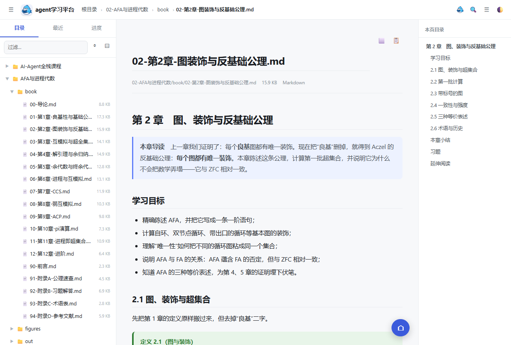
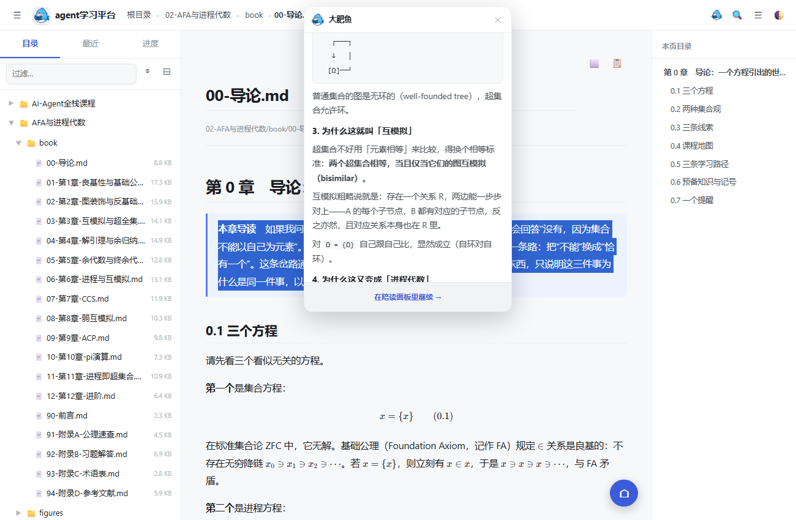
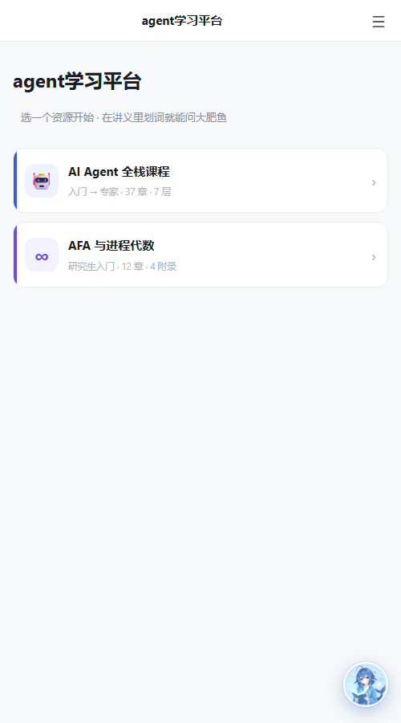
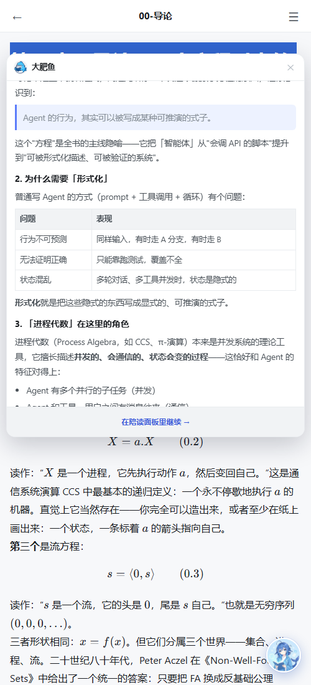

# 受够了付费墙和防贼式协议，我给自己写了一个「AI 陪读」阅读器

> 一个纯本地的学习阅读器：Markdown / KaTeX / 定理环境 / 划词问 AI，7000+ 行代码，不用服务器、不用登录、数据不出设备。


---

## 一、为什么要自己写

我平时看的技术书有三类：网上的课程讲义、别人整理的 Markdown 教材、还有一堆 PDF。用现成软件有两个绕不过去的问题：

**第一类问题是钱。** 阅读器要会员、AI 问答要买额度、导出要升级专业版。更离谱的是有些产品，你上传的资料它要收你"云端存储费"——而我根本不需要云，我就想在自己电脑上看。

**第二类问题是信任。** 有些协议写得很直白：禁止批量导出、限制同时登录设备数、后台扫描你上传的内容。我理解他们防的是盗版，但**我是在读一本我自己买的书**。

于是我决定自己写一个。

它只做一件事：**打开文件，读，不懂就问**。

---

## 二、成品长什么样

### 2.1 资源库首页

打开就是一个资源库，所有学习资料都在这里，选一个开始。

不再有"打开文件夹 → 找文件 → 选打开方式"这一套。


### 2.2 数学教材：公式和定理框

这是我自己整理的《AFA 与进程代数》，用 Markdown + LaTeX 写的。

关键在于**公式是真的 LaTeX 排版**，不是图片，也不是纯文本。旁边还有自动生成的本页目录。



定理、定义、引理、证明这些块，用 `::: definition` 这样的指令写，渲染成彩色框：

```markdown
::: definition 定义 2.1（图与装饰）
设 $G = \langle V, E \rangle$ 是一张有向图。**装饰**是一个映射
$d : V \to \mathcal{P}(V)$，满足 $d(v) = \{d(w) \mid w \in vE\}$。
:::
```

渲染出来是绿色的定义框，跟导出的 PDF 排版一致。

### 2.3 划词就地提问

这是我最喜欢的功能，也是整个项目的核心。

读到不懂的地方，**选中文字，点一下「问大肥鱼」**，旁边就地弹出一个小气泡，答案流式输出。

**眼睛不用离开那一行。** 不用切软件、不用复制粘贴、不用回来重新找读到哪了。



气泡还能**用鼠标拖着走**，对照原文看：

- 按住标题栏任意拖动
- 答案在流式生成、高度一直变，但**拖过之后不会被拽回去**
- 拖到屏幕边缘会被夹住，不会丢

气泡底部有「在陪读面板里继续 →」，想深聊就跳到完整面板，接着聊。

### 2.4 完整陪读面板

需要长对话时，右侧滑出完整面板。它知道你在读哪一章、哪一节、进度到哪。

### 2.5 手机端

手机上不是"缩小版"，是**独立的一套外壳**：单栏布局、顶部条、目录抽屉、右下角悬浮球。



底部还有「开始学习 →」，点课程进来直接跳第一章：


手机上划词也是同样的气泡：



---

## 三、技术选型：为什么这么"土"

| 层 | 选型 | 为什么 |
|---|---|---|
| 后端 | Python 标准库 `http.server` | 零依赖，`python server.py` 就能跑 |
| 前端 | 原生 JS，无框架 | 一共就那几个页面，上框架反而重 |
| 渲染 | marked + KaTeX + highlight.js | 都是成熟库，本地打包 |
| 存储 | 文件系统 + localStorage | 资料是文件夹，进度是小 JSON |
| AI | OpenAI 兼容接口 | DeepSeek / Kimi / 通义 / Ollama 全兼容 |

**整个项目没有 `package.json`，没有构建步骤，没有 npm install。**

改了代码刷新浏览器就生效——这在调试渲染细节时太爽了。

---

## 四、几个核心实现

### 4.1 渲染管线：四层保护 + 按序还原

Markdown 渲染最头疼的是**嵌套冲突**：代码块里有 `$`、公式里有 `*`、定理块里有代码。

做法是先把这些东西"藏起来"，最后按顺序还原：

```javascript
function renderMarkdown(md, baseDir) {
  var store = { code: [], math: [], thm: [] };

  md = protectCode(md, store);        // 1. 代码块 → 占位符
  md = protectMath(md, store);        // 2. 公式   → 占位符
  md = protectDirectives(md, store);  // 3. ::: 块 → 占位符

  var html = mdParse(md);             // 4. 解析 Markdown

  // 还原顺序很重要：code → thm → math → img → a
  html = restoreCode(html, store);
  html = restoreThm(html, store);     // 必须早于 math
  html = restoreMath(html, store);
  html = rewriteImages(html, baseDir);
  html = rewriteLinks(html);
  return { html: html, toc: extractToc(html) };
}
```

**踩过的第一个大坑就在这里**：还原顺序错了，定理框里的公式会露出 `⯑M12⯑` 这种占位符。

原因是定理块里含公式，如果先还原公式，公式的占位符在定理块内部——而定理块本身还是占位符，替换顺序一反，内容就错位了。

**正确顺序必须按"嵌套深度从外到内"**：先还原定理块（外层），再还原它内部的公式。

### 4.2 行内公式的正则：单字符是最容易漏的

最初的公式正则要求 `$...$` 里**至少两个字符**：

```javascript
/\$([^\s$][^$\n]*[^\s$])\$/g   // ❌ $V$ 匹配不上
```

结果数学教材里的 `$V$`、`$A$`、`$G$` 这种单字母变量**全部原样显示**。

数学书里单字符记号是最基础的东西，这个 bug 不修，整本书都没法看。改成中间那组可选：

```javascript
/(^|[^\w\\$])\$([^\s$](?:[^$\n]*?[^\s$\\])?)\$(?!\d)/g
```

前面加 `(^|[^\w\\$])` 是为了避免误吃 `a$b$c` 这种；后面 `(?!\d)` 是为了不把 `$100 and $200` 当成公式。

### 4.3 划词气泡：用 Pointer Events 做拖拽

```javascript
function makeDraggable(el) {
  var head = el.querySelector('.cp-inline-head');
  var dragging = false, offX = 0, offY = 0;

  head.addEventListener('pointerdown', function (ev) {
    if (ev.target.closest('.cp-inline-x')) return;   // 点关闭不算拖
    dragging = true;
    el.dataset.moved = '1';                          // 标记：用户已手动定位
    var r = el.getBoundingClientRect();
    offX = ev.clientX - r.left;
    offY = ev.clientY - r.top;
    head.setPointerCapture(ev.pointerId);            // 指针捕获，拖出元素也不丢
  });

  head.addEventListener('pointermove', function (ev) {
    if (!dragging) return;
    var vv = window.visualViewport;
    var vw = vv.width, vh = vv.height;
    el.style.left = Math.max(4, Math.min(vw - el.offsetWidth - 4, ev.clientX - offX)) + 'px';
    el.style.top  = Math.max(4, Math.min(vh - el.offsetHeight - 4, ev.clientY - offY)) + 'px';
  });
}
```

用 Pointer Events 而不是 mouse + touch 两套事件，**一套代码同时支持鼠标和手指**。

`el.dataset.moved` 这个标记很关键：答案是流式生成的，高度一直在变。如果每次都按选区自动定位，你刚把气泡拖到旁边，下一个字蹦出来它就被拽回去了。标记之后只做"不跑出屏幕"的夹取，不再重新定位。

### 4.4 `100vh` 在手机上是骗人的

气泡最初在手机上有时候"被截断"。原因：

```javascript
// ❌ 手机浏览器里 100vh 包含地址栏，实际可见高度小得多
el.style.maxHeight = Math.min(avail, Math.round(window.innerHeight * 0.66)) + 'px';
```

手机上 `100vh` ≈ 整个屏幕，但浏览器地址栏占掉的那部分你其实看不到。改成 `visualViewport`：

```javascript
var vv = window.visualViewport;
var vw = (vv && vv.width)  || window.innerWidth;
var vh = (vv && vv.height) || window.innerHeight;
var offTop = (vv && vv.offsetTop) || 0;   // 软键盘弹出时还要加上偏移
```

三段式定位：**优先放选区上方 → 放不下翻到下方 → 都放不下就贴顶（内容自己滚动）**。

### 4.5 双端分层：一套逻辑，两套外壳

这是我觉得最值得说的一点。

手机版不是"响应式挤压"，而是**独立的一套 HTML/CSS/JS**：

```
static/
├── index.html      电脑版外壳（251 行）
├── app.js          电脑版逻辑（1200 行）
├── style.css       电脑版样式
├── renderers.js    ← 共用：Markdown / KaTeX / 定理环境
├── companion.js    ← 共用：AI 陪读
└── m/
    ├── index.html  手机版外壳（164 行）
    ├── m.css       手机版样式（377 行）
    └── m.js        手机版逻辑（553 行）
```

关键设计：**手机版的 DOM 沿用了电脑版完全相同的元素 ID**。

`companion.js` 需要 32 个 `#cp*` 元素，手机版把同样的 ID 放进去、换成手机布局的 CSS —— 于是 **1221 行的陪读逻辑一行没改就复用了**。

算笔账：

```
如果两套完全独立：1200(电脑) + 1200(手机) + 1221(陪读×2) = 4800+ 行
现在：            1200 + 553 + 1221                     = 2974 行
```

**省下 1800 多行，而且以后每个 bug 只修一遍。**

### 4.6 本地优先：一个决定砍掉一整个后端

整个项目没有账号系统、没有数据库、没有鉴权。

因为架构是：**每个人跑自己的一份服务，数据从不离开设备**。

```python
ROOT = Path(r"C:\StudyAI").resolve()   # 资料根目录
HOST = "127.0.0.1"                     # 默认只听回环
```

这一个决定砍掉的：

| 砍掉 | 为什么不需要 |
|---|---|
| 账号 / 登录 / 找回密码 | 没有"别人" |
| JWT / 权限 / 多租户隔离 | 一台机器只有一个用户 |
| 数据库 / 迁移脚本 | 进度和笔记存 localStorage |
| 隐私政策 / 合规审计 | 数据没出过设备 |
| 服务器 / 带宽 / CDN / 备份 | 没有服务器 |
| API Key 托管 | Key 在用户自己机器上（这条法律风险最大） |

代价也有：**跨设备不同步**。但这个可以用"把资料文件夹放进网盘同步目录"解决，依然不需要服务器。

### 4.7 SSE 流式输出（手写）

不用任何框架，手写 chunked 编码：

```python
self.send_response(200)
self.send_header("Content-Type", "text/event-stream; charset=utf-8")
self.send_header("Cache-Control", "no-cache, no-transform")
self.send_header("X-Accel-Buffering", "no")
self.end_headers()

for delta in upstream_stream:
    self.wfile.write(("data: " + json.dumps({"type":"delta","text":delta}, ensure_ascii=False) + "\n\n").encode())
    self.wfile.flush()
self.wfile.write(("data: " + json.dumps({"type":"done"}) + "\n\n").encode())
```

前端用 `XMLHttpRequest` 的 `readyState === 3` 做增量解析：

```javascript
xhr.onreadystatechange = function () {
  if (xhr.readyState !== 3 && xhr.readyState !== 4) return;
  var raw = xhr.responseText || '';
  var chunk = raw.slice(lastLen);      // 只取新增部分
  lastLen = raw.length;
  // 按 \n\n 切事件，解析 data: 行
};
```

用 XHR 而不是 `fetch`，是因为 `fetch` 的流式读取在部分浏览器上更麻烦，而 XHR 的 `responseText` 天然累积，切增量很直接。

---

## 五、踩坑记录

写代码的时间大概占三分之一，剩下三分之二都在踩坑。

**① `::: definition` 原样显示成文本**

`marked` 不认这种语法。解决办法是自定义占位符——但 HTML 注释占位符 `<!--THM0-->` 会被 `marked` 当 HTML 块原样透传，反而好办，可以精准替换。

**② 定理框里露出 `⯑M12⯑`**

还原顺序问题。定理块必须在公式之前还原。详见 4.1。

**③ 教材图片全部裂开**

教材里写 `figures/fig-map.png`（按项目根目录），但 md 文件在 `book/` 下。

```javascript
// 回退：md 在 book/ 里时，去掉 book/ 再拼一次
function resolveAssetPath(baseDir, rel) {
  var direct = resolvePath(baseDir, rel);
  if (/(^|\/)book$/.test(baseDir)) {
    var alt = resolvePath(baseDir.replace(/\/book$/, ''), rel);
    if (alt !== direct) return alt;
  }
  return direct;
}
```

**④ 手机版公式渲染成纯文本**

排查了半天，最后发现是**手机版 HTML 漏引了 `katex.min.css`**。

公式节点明明生成了（DOM 里 68 个 `.katex`），但没有排版规则，退化成了普通文字。

教训：**"渲染了"和"渲染对了"是两件事**。

**⑤ 我用截图调试，被截图骗了**

手机版截图里看不到右下角悬浮球，我以为 CSS 坏了。查了半天，写了个探针脚本读 `getComputedStyle` + `getBoundingClientRect`：

```
cpOrb: disp=block pos=fixed z=88 box=420,732 56x56
viewport=492   docScrollW=492
```

**元素在 x=420，而视口是 492 —— 它一直在正确位置。** 是我截图窗口开的 412 宽，只截了左边一部分。

教训：**调试布局不要只看截图，要读计算样式。**

**⑥ Windows 防火墙静默拦截**

手机连不上，查出来是 `python.exe` 有一条 `Inbound / Block` 规则（大概是以前某次弹窗点了取消时自动建的）。

**⑦ 手机上长按选词不触发 `mouseup`**

划词气泡在数学页不出现。原因是我只给 iframe 内部绑了 `selectionchange`，**父文档没绑**——而手机上长按选词主要靠 `selectionchange`。

---

## 六、项目地址

**GitHub：** <https://github.com/LazyFox-007/Agent-Learning>

**Gitee（国内快）：** <https://gitee.com/haveink/agent-learning-platform>

```bash
git clone https://gitee.com/haveink/agent-learning-platform.git
cd agent-learning-platform
python _webapp/server.py
# 打开 http://127.0.0.1:8777/
```

**零依赖**，Python 3.8+ 就能跑。不需要 `pip install`，不需要 `npm install`。

仓库里自带两套学习资料：

- **AI Agent 全栈课程**（37 章，callous-0923 编写，MIT）
- **AFA 与进程代数**（12 章 + 4 附录，Markdown + LaTeX）

---

## 七、后续

- [ ] 服务端 gzip 压缩（现在 600 KB 原样传，能压到 180 KB）
- [ ] 首屏懒加载（KaTeX 266 KB 只在打开文档时加载）
- [ ] 资源包规范（`course.json`），让别人丢个文件夹就能加自己的资料
- [ ] 把资料文件夹放进网盘，实现"不要服务器的多设备同步"

---

## 八、最后

这个项目有 7000+ 行代码，其中一大半时间花在"让公式排版跟 LaTeX 一样好看"、"让手机上不横向滚动"、"让气泡不被截断"这种琐事上。

但也正是这些琐事，决定了它是"一个能打开文件的软件"还是"一个愿意天天用的阅读器"。

**功能上做减法，质量上做加法。**

如果这个思路对你有用，欢迎 star，或者直接 fork 改成你自己的阅读器——资料目录就是普通文件夹，换内容不用改代码。

---

*本文所述软件为个人自用工具，不含任何付费功能、广告或数据采集。*
